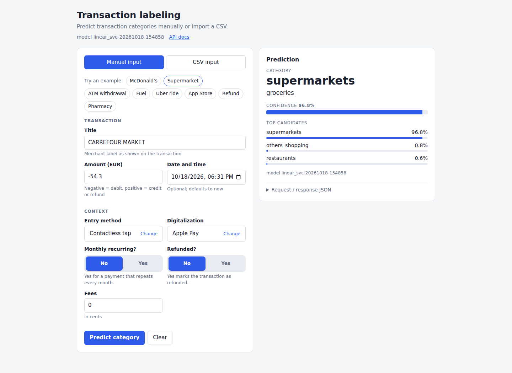

**Live demo:** [Transaction labeling](https://zihao-guo.github.io/lydia_zihao-eric/) · [API docs](https://lydia-transaction-api-504999617745.europe-west1.run.app/docs)

# Transaction labeling — card-transaction category classifier

Each card transaction gets one of 12 minor categories and one of 8 major categories, using only fields available at payment time. The model is a sigmoid-calibrated linear SVM on character and word n-grams of the normalised title plus categorical and numeric features; the major category comes from a fixed taxonomy, a deterministic rule handles refunds, and a FastAPI service serves it. Evaluation uses the complete prediction flow, with Accuracy as the primary business metric, Macro-F1 and unseen-title accuracy as key constraints, and probability calibration assessed separately below.

Supporting material: [`notebooks/eda.ipynb`](notebooks/eda.ipynb), `models/metrics.json`, `models/model_comparison.csv`, `models/evaluation.json`, `models/model_card.json`.

## Try the live demo

Open the [live frontend](https://zihao-guo.github.io/lydia_zihao-eric/) and wait for the model version to appear at the top.



1. **Try an example:** click **Supermarket** or another example to fill the form and run a prediction immediately. The screenshot shows `CARREFOUR MARKET` classified as `supermarkets`, with major category `groceries`.
2. **Enter a transaction:** fill in the title and amount, adjust any optional context, then click **Predict category**. Negative amounts represent debits; positive amounts trigger the refund rule. The result panel shows the category, confidence, and top candidates.
3. **Predict a CSV:** switch to **CSV input**, upload a file or paste CSV with `title` (or `merchant_name`) and `amount_value` columns, then click **Preview** and **Predict CSV**. Results follow the CSV row order.

## Repository layout

```
.
├── README.md                    this file
├── requirements.txt             pinned dependencies
├── data/
│   └── transactions.csv         raw data (8,121 rows)
├── notebooks/
│   └── eda.ipynb                executed exploratory analysis, sections 1-9
├── src/
│   ├── preprocessing.py         taxonomy, cleaning, split, features
│   ├── models.py                model zoo and hyper-parameter grids
│   ├── train.py                 training, comparison, artifact writing
│   ├── evaluate.py              evaluation, error buckets, provenance
│   ├── predict.py               Predictor, refund rule, command line
│   ├── train.sh                 install, train, evaluate
│   ├── api/
│   │   ├── main.py              FastAPI app and routes
│   │   ├── schemas.py           request and response models
│   │   └── index.html           web form served at /
│   ├── deploy/                  containers, hosting scripts and deployment guide
│   └── tests/                   pytest suite
└── models/
    ├── model.joblib             trained pipeline plus metadata
    ├── metrics.json             all candidates, legend
    ├── model_card.json          intended use, metrics, limitations
    ├── model_comparison.csv     the comparison as a table
    └── evaluation.json          test-period deep dive
```

## Approach and key design choices

- **Predict minor, derive major.** Minor determines major in every row; a second model would add inconsistent pairs.
- **Refund rule.** All 123 refund rows have `status == "refunded"` and `amount_value > 0`, and no other row does. Either condition fires it, overriding the probabilities.
- **Text.** Lower-cased, accent-stripped titles; char_wb 2-5-gram and word 1-2-gram TF-IDF (sublinear, `min_df=2`); char n-grams absorb spelling drift (McDonald's has 14 normalised variants).
- **Features.** Kept: entry method, digitalization, recurrence, status, `log1p(|amount|)`, sign, fees, time and round-amount flags. Dropped: `card_name` (mutual information 0.0286 vs a 0.0261 permutation baseline), identifiers, constants.
- **Deduplication before splitting:** 120 exact repeats removed, 8,001 rows remain.
- **Validation.** Temporal split: the first 80 % by `created_at` trains (6,400 rows), the last 1,601 test, from 2026-05-24. Selection uses 5-fold stratified CV on the training period; a 5-fold StratifiedGroupKFold by normalised title gives the cold-start view.
- **Selection.** Model selection uses training-period cross-validation only; the held-out test period is used for reporting. Exact ranking rules and training diagnostics are in `models/metrics.json`.
- **Model zoo.** Majority class, title lookup, logistic regression, calibrated linear SVC, text-only SVC ablation.
- **One artifact, shared preprocessing.** The artifact holds the whole pipeline and every stage imports `src/preprocessing.py`, so serving cannot drift from training.

The exploratory analysis behind these choices (nulls, duplicates, class balance, title spelling variants, label agreement per title, feature signal, amounts, time, identifiers) is in `notebooks/eda.ipynb`, sections 1–9.

## Result analysis

Lydia's PFM task automatically classifies every transaction. If all misclassifications have similar business costs, the proportion of transactions classified correctly is the most direct product metric. **Accuracy of the complete prediction flow is therefore the primary business metric.**

The evaluated flow includes input normalisation, model inference, and the deterministic refund rule, producing the final minor category returned by the API. Major categories are derived from the fixed taxonomy. All classification results below use this same complete flow on the held-out final 20 % of the timeline (1,601 transactions).

- **Accuracy — primary:** correctly classified transactions divided by all test transactions.
- **Macro-F1 — class-balance constraint:** the unweighted mean F1 over the 12 minor categories; it checks whether overall Accuracy hides weak performance on less frequent categories.
- **Unseen-title accuracy — generalisation constraint:** Accuracy on the 78 test transactions whose normalised title never appeared in training; it checks whether performance extends beyond familiar titles. This measures unseen title strings, not unseen merchant entities.

| Model | Accuracy (primary) | Macro-F1 | Unseen-title accuracy |
|---|---|---|---|
| Majority baseline | 32.29% | 0.1229 | 21.79% |
| Merchant lookup | 92.63% | 0.8961 | 21.79% |
| Text-only SVC (ablation) | 94.69% | 0.9320 | 74.36% |
| Logistic regression | 95.25% | 0.9396 | 78.21% |
| **Calibrated linear SVC (selected)** | **95.50%** | **0.9413** | **79.49%** |

The selected flow correctly classifies 1,529 of 1,601 transactions (Wilson 95% interval: 94.37–96.41%). For unseen titles, it gets 62 of 78 correct (69.25–86.96%); that smaller sample leaves substantial uncertainty. Most test transactions have titles already present in training, so the headline Accuracy reflects the current merchant mix. No acceptance thresholds for the two constraints have been set; these results are a baseline for setting them with the product team.

The model improves on merchant lookup by 2.87 percentage points in overall Accuracy and 57.69 points on unseen titles. Structured features improve on the text-only model by 0.81 and 5.13 points respectively. Logistic regression is only four test transactions behind the selected SVC, so the overall difference is small. Of the 72 errors, 16 involve unseen titles, 12 titles with fewer than five training examples, and 44 titles with at least five training examples where the prediction matches one of the most frequent training labels.

### Probability calibration — separate assessment

Classification scores assess the chosen category; calibration asks whether the returned confidence matches the observed probability of being correct. The SVC uses sigmoid calibration. Re-evaluating the committed artifact on the same 1,601 test transactions, including the refund rule, gives:

| Probability diagnostic | Value | Definition |
|---|---|---|
| Top-label expected calibration error (ECE) | 0.0399 | Weighted absolute gap between mean confidence and observed Accuracy in 10 equal-width confidence bins |
| Multiclass Brier score | 0.0857 | Mean sum of squared errors across all 12 class probabilities; unscaled, range 0–2 |
| Log-loss | 0.2461 | Mean negative log probability assigned to the true class |

Lower is better for all three. ECE directly summarises binned confidence agreement; Brier score and log-loss assess overall probability quality and also depend on discrimination. Mean confidence is 91.68%, compared with 95.50% observed Accuracy, suggesting conservative confidence overall; this does not establish calibration for every class or title group. ECE depends on binning, and sparse bins are uncertain. Any recalibration or confidence threshold should be fitted on validation data and checked on a fresh holdout.

Full training diagnostics and error details remain in `models/metrics.json`, `models/model_card.json`, and `models/evaluation.json`.

## How to run training

Python 3.11; run from the repository root.

```bash
python -m venv .venv && source .venv/bin/activate
pip install -r requirements.txt
python -m pytest        # 207 tests, about 15 s
```

```bash
./src/train.sh              # one command: install pinned dependencies, train, evaluate
./src/train.sh --quick      # smoke run; no evaluation
```

Training writes `model.joblib`, `metrics.json`, `model_card.json` and `model_comparison.csv` to `--out`. `--quick` without `--out` goes to `/tmp/transaction-labeling-quick`, never over `models/`. Alternatives:

```bash
python -m src.train                  # all five models, full grid search
python -m src.train --quick --out /tmp/lydia-quick   # smoke test, kept out of models/
python -m src.train --models logreg,linear_svc --out /tmp/run1
```

| Flag | Meaning |
|---|---|
| `--models` | comma-separated subset of `majority, merchant_lookup, logreg, linear_svc, linear_svc_text` (default: all) |
| `--quick` | stratified subsample (about 1,200 train / 300 test rows), 2-fold CV, no grid search; same temporal cut |
| `--out` | output directory (default `models/`) |
| `--data` | input CSV (default `data/transactions.csv`) |

```bash
python -m src.evaluate               # re-checks the committed artifact on the test period
python -m src.predict --title "NETFLIX.COM" --amount -13.49
```

`src.evaluate` checks provenance (MD5, split date, row counts) and reproduces the stored accuracy; `src.predict` is the one-line command-line predictor.

## How to run the prediction service

Same environment as training:

```bash
uvicorn src.api.main:app --port 8000
LYDIA_MODEL_PATH=/path/to/model.joblib uvicorn src.api.main:app --port 8000   # another artifact
```

Web form at `http://localhost:8000/`, OpenAPI at `/docs`.

| Route | Purpose |
|---|---|
| `GET /health` | readiness: `{"status":"ok","model_loaded":true,"model_version":...}`; **503** when no model is loaded |
| `GET /v1/model` | artifact metadata and metrics |
| `POST /v1/predict` | one transaction -> one prediction |
| `POST /v1/predict/batch` | JSON list of transactions (at most 1,000) -> list of predictions |

Request body (`POST /v1/predict`; the batch route takes a list of the same objects):

| Field | Type | Required | Default | Note |
|---|---|---|---|---|
| `amount_value` | number | yes | | signed (negative = debit, positive = credit/refund), finite, absolute value at most 1e9 |
| `title` | string | one of the two | | merchant text; `title` or `merchant_name` must be non-blank |
| `merchant_name` | string | one of the two | | used when `title` is missing |
| `created_at` | string | no | | ISO 8601 only (date-only means midnight UTC); missing -> hour and weekday -1, weekend flag 0 |
| `status` | string | no | `completed` | `refunded`, or any positive `amount_value`, triggers the refund rule (prediction `refund`, confidence 1.0) |
| `merchant_pan_entry_method`, `digitalization_type`, `pfm_recurring_frequency` | string | no | | optional strings (e.g. `chip_contactless`, `apple_pay`, `monthly`); unknown values are ignored by the encoder |
| `fees` | integer | no | 0 | cents, 0 to 100,000,000 |
| `amount_currency`, `card_name`, `transaction_id` | string | no | `EUR` / null / null | accepted but unused (`transaction_id` is echoed back) |
| any other field | any | no | | accepted and ignored (e.g. `ref_id`, `member_id`, `card_type`) |

Example request and response:

```bash
curl -s -X POST localhost:8000/v1/predict -H 'Content-Type: application/json' \
  -d '{"title": "MC DONALD'"'"'S", "amount_value": -12.5, "created_at": "2026-06-01T12:30:00Z",
       "merchant_pan_entry_method": "chip_contactless", "digitalization_type": "apple_pay"}'
```

```json
{"transaction_id":null,"minor_category":"restaurants","major_category":"restaurants_bars_cafes","confidence":0.9527931024916834,"top_k":[{"label":"restaurants","probability":0.9527931024916834},{"label":"transport_means","probability":0.016257078203837688},{"label":"supermarkets","probability":0.009271843479240193}],"model_version":"linear_svc-20261018-154858"}
```

Errors: invalid input gives **422** with a list-shaped `detail`, for example `{"detail":[{"type":"missing","loc":["body","amount_value"],"msg":"Field required"}]}`; bodies are never logged. A missing model gives **503** `{"detail":"model not loaded"}`; an unloadable model file fails startup.

- The model is loaded once at startup (single process, CPU only); `model.joblib` is a pickle, so load only artifacts you trust.
- The three returned probabilities are the top 3 of 12 and need not sum to 1; `major_category` is `null` for `refund`.

## Assumptions and trade-offs

- **Synthetic data.** Real noise and merchants will differ.
- **Label quality.** Some errors on familiar titles are assumed to reflect inconsistent labels. This is a working assumption that requires manual label review.
- **Availability.** `status` and recurrence are assumed known at transaction time.
- **Recurrence encoding.** Missing `pfm_recurring_frequency` is encoded as `none` (non-recurring).
- **Holdout inspected.** I viewed the full frame, test period included, during EDA; selection used training-period CV only.
- **Single window, UTC.** 2026-03-13 to 2026-06-10: no seasonality or drift estimate; hour and weekday are UTC.

## How I imagined the rest

- A merchant-id cache of confirmed labels in front of the model, which stays as fallback.
- Relabel the high-volume mixed-label titles (`apple com bill`, `intermarche`, `carrefour city`).
- Per-class thresholds, human review of low-confidence rows, a reliability diagram first.
- Monitoring of unseen-title share, class mix and confidence drift.
- A cold-start model (char n-grams plus a small multilingual embedding), a model registry, and CI running the tests and a `--quick` training run.

## Reproducibility

- Seed 42 everywhere; scores and predictions are deterministic for the pinned versions, timings, timestamps and `model_version` are not.
- The artifact is committed, so the API runs without retraining.
- `python -m src.evaluate` re-checks it against the data (MD5, split date, row counts) and reproduces the complete-flow Accuracy (95.50%).
