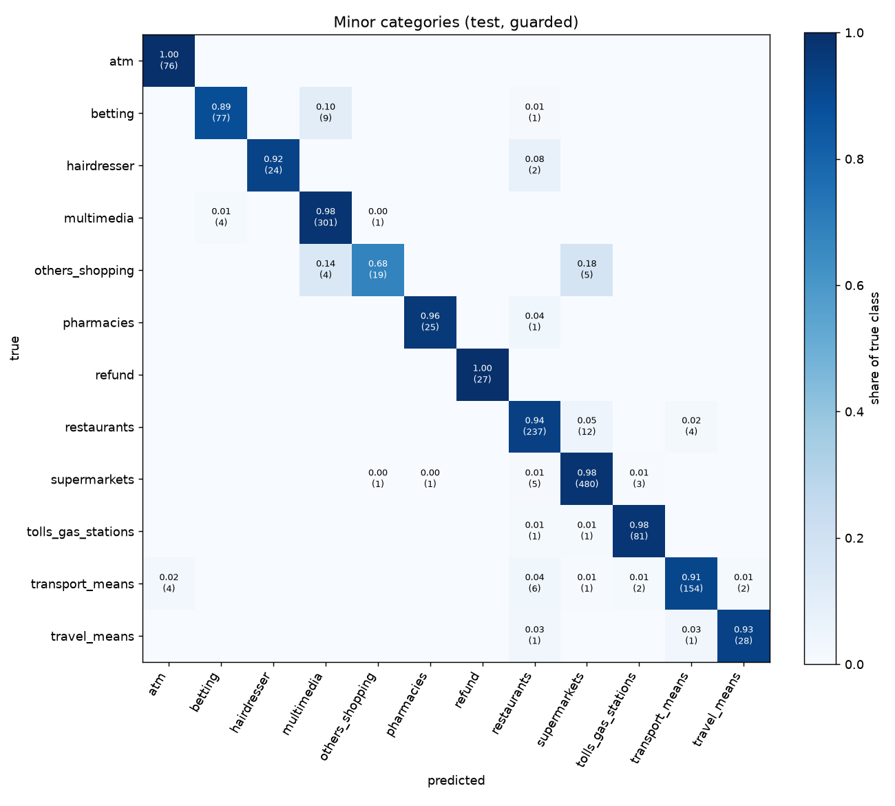
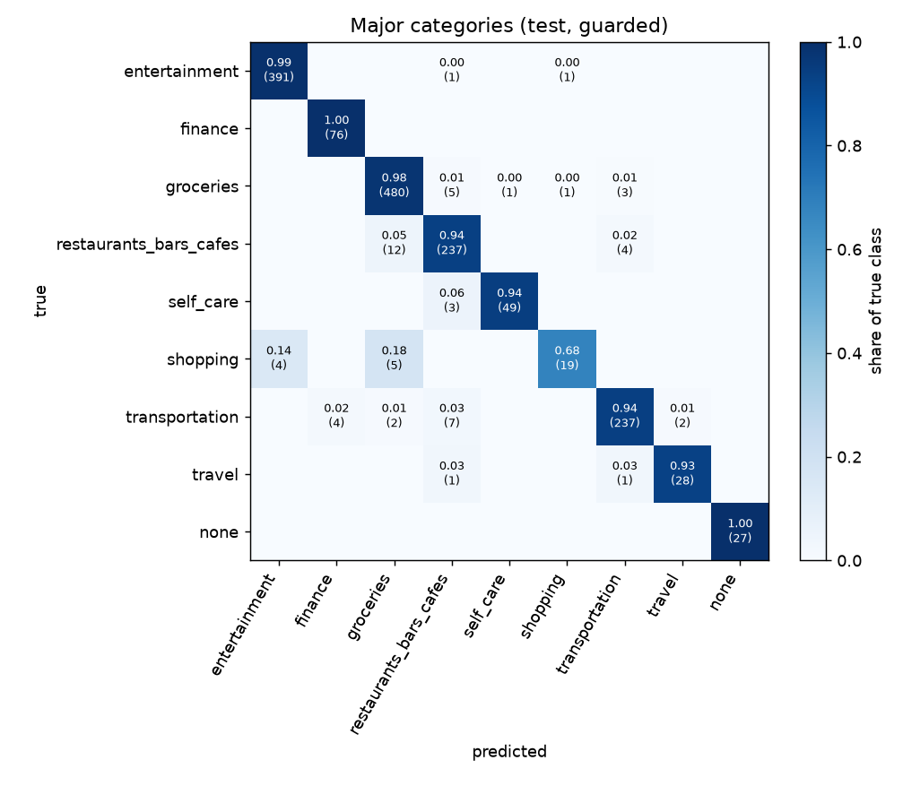
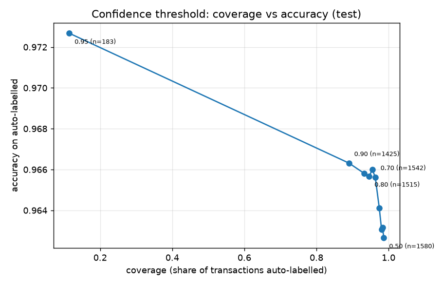

# Error analysis

**Takeaway.** 95.5 % guarded test accuracy; most errors (44 of 72) sit on titles whose training labels disagree; merchants unseen in training drop to 79 %.

Model `linear_svc-20261018-151345`, evaluated on the temporal holdout (1,601 rows, from 2026-05-24T11:07:07+00:00). Tables are copied from `reports/error_analysis_tables.md`, `models/evaluation.json` and `models/model_comparison.csv`. Counts marked *(computed)* were derived from `reports/test_errors.csv`, which lists the 72 rows the served (guarded) model gets wrong.

## 1. Headline numbers

The selected model is `linear_svc`: a sigmoid-calibrated LinearSVC on character and word TF-IDF of the normalised title plus categorical and numeric features. The pre-registered rule picks the highest 5-fold CV accuracy, then CV macro-F1, then CV log-loss, then name. `linear_svc` has the highest CV accuracy (0.9403). The choice used training-period CV only.

| variant | CV accuracy (train period) | test accuracy [95% Wilson CI] | n | macro-F1 | log-loss | major accuracy |
|---|---|---|---|---|---|---|
| raw (model only) | 0.9403 | 0.9538 [0.9424, 0.9630] | 1601 | 0.9350 | 0.2476 | 0.9631 |
| guarded (served) | n/a (CV scores are raw) | 0.9550 [0.9437, 0.9641] | 1601 | 0.9413 | 0.2461 | 0.9644 |

Raw is the model alone. Guarded applies the deterministic refund rule (`status == "refunded"` or positive amount) after prediction. Guarded is the headline because it is what the service returns.

- **What the guard changes.** Raw gets 1,527 rows right and guarded 1,529. The guard fixes a net 2 errors (computed: 1529 - 1527 from the interval counts in `evaluation.json`). The model already finds refunds well. The guard matters more for weaker models (section 2).
- **Major level.** Guarded major accuracy is 0.9644, only 0.9 points above minor accuracy. Of the 72 guarded errors, 57 are also wrong at major level and 15 vanish (computed from `test_errors.csv` by mapping each class to its major category). Check: (1601 - 57) / 1601 = 0.9644.
- **The 15 that vanish.** 13 are betting and multimedia confused with each other (9 true betting predicted multimedia, 4 true multimedia predicted betting). Both are `entertainment`. 2 are true `transport_means` predicted `tolls_gas_stations`. Both are `transportation`.

## 2. Baseline to iteration

| model | cv_accuracy | coldstart_accuracy | test_accuracy_guarded | seen_accuracy | unseen_accuracy |
|---|---|---|---|---|---|
| majority | 0.2892 | 0.3038 | 0.3229 | 0.3283 | 0.2179 |
| merchant_lookup | 0.8884 | 0.3038 | 0.9263 | 0.9626 | 0.2179 |
| logreg | 0.9364 | 0.7913 | 0.9525 | 0.9613 | 0.7821 |
| linear_svc_text | 0.9189 | 0.7284 | 0.9469 | 0.9573 | 0.7436 |
| linear_svc | 0.9403 | 0.7989 | 0.9550 | 0.9632 | 0.7949 |

The merchant lookup is strong on seen titles (0.9626, close to the SVC's 0.9632) and collapses on unseen ones (0.2179, the same as predicting the majority class).

The structured features (entry method, digitalization, status, recurrence, amount, time) add points over the title-only ablation `linear_svc_text`. The gap is 2.1 points in CV (0.9189 to 0.9403), 2.4 points on raw test accuracy (0.9300 to 0.9538).

On cold-start CV the gap is 7.1 points (0.7284 to 0.7989) (cold-start CV is scored with the refund rule, like the guarded test numbers). On guarded test accuracy it shrinks to 0.8 points (0.9469 to 0.9550). The reason is that the text-only model gains 1.7 points from the guard (0.9300 to 0.9469) while the SVC gains 0.1. Part of the raw gap is refund detection that the rule already provides. All gaps above are computed from `model_comparison.csv`.

`logreg` and `linear_svc` are within noise. The raw test gap is 2 rows and the guarded gap 4 rows (computed: gap x 1,601). The SVC's interval [0.9437, 0.9641] contains the logreg point estimate 0.9525. The selection therefore rests on the pre-registered CV rule (0.9403 vs 0.9364), not on the test set.

## 3. Where the model is wrong

Top confusions among guarded errors (condensed from the generated table; text is the normalised title):

| title | true | predicted | count |
|---|---|---|---|
| apple com bill | betting | multimedia | 4 |
| bene bono | supermarkets | restaurants | 2 |
| create | hairdresser | restaurants | 2 |
| intermarche | restaurants | supermarkets | 2 |
| la banque postale | transport_means | atm | 2 |
| la belle epoque | restaurants | transport_means | 2 |
| mc donald s | transport_means | restaurants | 2 |
| netflix com | others_shopping | multimedia | 2 |

No single pair exceeds 4 rows. The errors are spread thin: 10 true classes appear among the 72 errors (computed). The largest are restaurants 16, transport_means 15, supermarkets 10, betting 10 and others_shopping 9 (computed).

**Weak spots.**
- `others_shopping` has recall 0.6786 on 28 rows (F1 0.7755), the lowest of any class. Its 9 missed rows go to supermarkets (5) and multimedia (4) (computed). Most of these titles read like a grocer or a streaming service.
- `betting` has recall 0.8851 on 87 rows. 9 of its 10 errors are predicted multimedia (computed), 4 of them on the single title `apple com bill`.
- `transport_means` has recall 0.9112 on 169 rows. Its 15 errors (computed) include McDonald's and bank-branch titles labelled transport.

**Examples from the bucket tables** (title, true, predicted, confidence):

| group | title | true | predicted | confidence |
|---|---|---|---|---|
| cold_start | LE DIPLOMATE | supermarkets | restaurants | 0.9105 |
| cold_start | GOOGLE *Phone Dialer C | betting | multimedia | 0.9038 |
| cold_start | STATION BD DE L | supermarkets | tolls_gas_stations | 0.6735 |
| thin_support | PHARMACIE DE LA | supermarkets | pharmacies | 0.9450 |
| thin_support | MICROSOFT*SUBSCRIPTION | others_shopping | multimedia | 0.9074 |
| thin_support | DeezerFR DEEZER | betting | multimedia | 0.9045 |
| title_majority | UBR* PENDING.UBER.COM | restaurants | transport_means | 0.9581 |
| title_majority | MC DONALD'S | transport_means | restaurants | 0.9534 |
| title_majority | AUCHAN SUPERMAR | others_shopping | supermarkets | 0.9528 |

The cold-start misses are plausible guesses (`LE DIPLOMATE` read as a restaurant). In thin_support, `PHARMACIE DE LA` labelled supermarkets looks like a label problem. The title_majority rows are the opposite case. The model is confident and is following what the training data says for that title.

## 4. Seen vs unseen merchants

| subset | accuracy [95% Wilson CI] | n | errors |
|---|---|---|---|
| seen titles | 0.9632 [0.9526, 0.9716] | 1523 | 56 |
| unseen titles | 0.7949 [0.6925, 0.8696] | 78 | 16 |

"Seen" means the normalised title occurs in the training period. Error counts are n minus the correct counts in `evaluation.json` (1523 - 1467 and 78 - 62). They match the bucket counts in `test_errors.csv`: all 16 `cold_start` rows are the unseen errors, and the 56 seen errors are the 12 thin_support plus the 44 title_majority rows (computed).

Errors among the 78 unseen rows, by true class (computed from `test_errors.csv`): supermarkets 5, betting 3, transport_means 3, and one each for pharmacies, travel_means, tolls_gas_stations, others_shopping and restaurants. 10 of the 16 are predicted restaurants (computed). Unseen titles tend to be read as restaurants.

The intervals do not overlap: the seen lower bound (0.9526) is above the unseen upper bound (0.8696). Unseen merchants are a different regime.

What generalises is category words in the title (for example "pharmacie" or "station"). What does not is brand names. A new brand (`LE DIPLOMATE`, `bene bono`, `napoleon games`) carries no learned association. The title-grouped cold-start CV tells the same story at 0.7989 (fold standard deviation 0.0837).

## 5. Error buckets: suspected label noise vs fixable

| bucket | n | share |
|---|---|---|
| refund_rule | 0 | 0.0000 |
| cold_start | 16 | 0.2222 |
| thin_support | 12 | 0.1667 |
| title_majority | 44 | 0.6111 |
| other | 0 | 0.0000 |

Buckets are assigned in this order; the first match wins (`docs/design.md`, error-bucket decision).

- `refund_rule`: the true or predicted class is refund.
- `cold_start`: the normalised title is absent from the training period.
- `thin_support`: the title has fewer than 5 training rows.
- `title_majority`: the model predicted one of the labels tied for the title's highest training count. The label is therefore the suspect. This is *unverified*: it shows the labels are inconsistent, not which one is right.
- `other`: none of the above.

**Split.** 44 of 72 errors (61.1%) are suspected label-side (`title_majority`). 28 of 72 (38.9%) are potentially fixable (`cold_start` 16 plus `thin_support` 12). Both shares are computed from the bucket counts.

Three checks on the title_majority bucket, computed from `test_errors.csv`:
- The median model confidence is 0.935, and 42 of the 44 rows are at 0.90 or above.
- On a hand list of ambiguous retailers and platforms, 28 of the 44 rows fall on the list. The list is: Auchan, Carrefour (three spellings), Intermarche, Monoprix, Franprix, Centre Leclerc, Cocci Market, Spar, Apple bill, Amazon, Netflix, Google One, Canal Plus, McDonald's (two spellings). I chose the list by eye, so the 28 is indicative.
- `apple com bill` alone accounts for 5 of the 72 errors. EDA found it carries four labels (multimedia 1,048, betting 26, others_shopping 20, refund 16).

Caveat: `other` is empty, so every remaining error agrees with the title's training majority or has too little history to say. A model that copied each title's majority label would make these same 44 mistakes. Most need relabelling to fix. Some may not be label errors at all (the `G7` row is a normalisation collision).

## 6. Confidence and coverage

| threshold | coverage | accuracy on covered | covered rows |
|---|---|---|---|
| 0.80 | 0.9463 | 0.9657 | 1515 |
| 0.90 | 0.8901 | 0.9663 | 1425 |
| 0.95 | 0.1143 | 0.9727 | 183 |

The calibrated SVC has a narrow confidence band: only 11% of rows clear 0.95, and moving from 0.90 to 0.95 drops coverage from 89.0% to 11.4%. Accuracy on the covered rows barely moves (0.9663 to 0.9727). The model is rarely very sure, and being sure does not make it much more accurate.

Confidence separates errors from correct answers poorly. The 72 errors have median confidence 0.929, and 48 of them are at 0.90 or above (computed from `test_errors.csv`). Cold-start errors are the easier ones to catch (median 0.477, computed). Title_majority errors are confident (median 0.935).

At the exploratory 0.50 threshold, 1,580 of 1,601 rows are answered, 1,521 correctly (96.27%, Wilson 95.21% to 97.09%), and 21 abstain. That figure was read off the test set. It is not a tuned operating point.

The operating point is a product decision. It trades review workload against error rate, and it should be chosen and frozen on validation data. `logreg` had the lower CV log-loss (0.3008 vs 0.3078; also on test, 0.2251 vs 0.2476), so if probabilities rather than labels drive the routing, that comparison is worth revisiting.

## 7. Limitations and assumptions

- **Synthetic data.** The labels and merchants do not come from a real labelling process. Absolute numbers should not be carried over to production.
- **Label inconsistency is inferred.** The title_majority reading comes from the training labels alone. No label was checked against ground truth.
- **Contract assumption.** `status` and `pfm_recurring_frequency` are assumed to be available at transaction time. The refund guard depends on `status`.
- **Time features are UTC.** Hour and day of week are not local time.
- **Normalisation collisions.** Digit-only titles normalise to an empty string (31 titles, 30 of them ATM, per the EDA). `G7` normalises to `g`, which collides with `G 20`: in `test_errors.csv` the row `G7`, true transport_means, is predicted supermarkets at confidence 0.7171 from 5 training rows whose majority label is supermarkets.
- **Sample size.** The test set has 1,601 rows (about +/-1 point). The unseen subset has 78 rows (about +/-9 points, from the interval 0.6925 to 0.8696).
- **Cold-start CV bias.** Grouping by normalised title still shares spelling variants across folds (optimistic). It also holds out whole giant title groups (pessimistic). The 0.7989 is an estimate with a wide spread, not a point of truth.
- **Holdout was inspected.** The full frame, holdout included, was looked at during EDA. Model selection used CV on the training period only.
- **Single window.** Three months of data, no drift monitoring.

## 8. What I would do next

- Add a merchant-id cache of confirmed labels, so a merchant corrected once stays corrected.
- Relabel the high-volume mixed-label titles first (`apple com bill`, `intermarche`), then re-measure. Together they account for 7 of the 44 title_majority errors.
- Add per-class thresholds and a review route, since `others_shopping` and `betting` may need a different cut-off from `supermarkets`.
- Plot a reliability diagram before choosing any threshold. Only coverage and accuracy-on-covered were measured here.
- Monitor weekly: share of unseen titles (4.9% of test rows here), class mix and the confidence distribution.
- Build a cold-start model (character n-grams plus a small multilingual embedding) and benchmark it on the title-grouped CV (0.7989 to beat).
- Confirm the data contract for `status` and recurrence with the data owner.

Sources: `reports/error_analysis_tables.md`, `reports/test_errors.csv`, `reports/model_comparison.md`, `models/evaluation.json`, `models/metrics.json`, `models/model_comparison.csv`, `models/model_card.json`, `reports/eda_findings.md`, `docs/design.md`, `figures/confusion_minor.png`, `figures/confusion_major.png`, `figures/confidence_coverage.png`.
